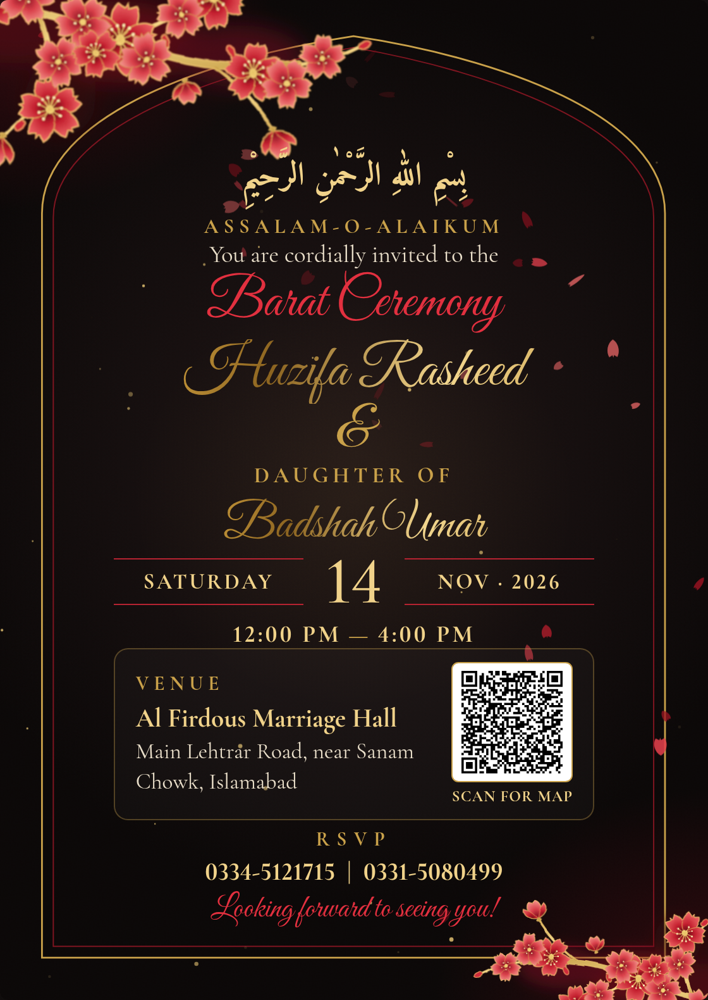

# Invite Studio

Animated wedding invitation cards: one data file in, five designs out, each as a web page and a WhatsApp-ready PNG.
It started as a Barat invitation for Kamal's sister (live at https://oyekamal.github.io/walima-invite/). The plan is to grow it into an app where any family types in their details and gets a beautiful card.

## What's here

| File | What it does |
|---|---|
| `invite.js` | **The only file a family edits.** Names, event, date, time, venue, map search, RSVP numbers, closing line, default design. |
| `index.html` | The template. All five designs, the design picker, the envelope intro, the wind animation, and the action buttons. It fills itself from `invite.js`. |
| `qr.svg` | The QR code on the card. It opens the venue in Google Maps. Generated, don't edit by hand. |
| `card-<design>.png`, `card.png` | Still images of each design (1120×1580) for WhatsApp and printing. `card.png` is the default design and the link-preview image. |
| `tools/make_qr.py` | Rebuilds `qr.svg` from `maps_query` in `invite.js`. |
| `tools/render_cards.py` | Renders every `card-*.png` in headless Chrome and checks that each QR code scans to the map link. |

## Make a new invitation (today, by hand)

1. Edit `invite.js`.
2. Run `python3 tools/make_qr.py`. It needs `pip install -r tools/requirements.txt`.
3. Run `python3 tools/render_cards.py`. It needs Chrome or Chromium installed.
4. Open `index.html` to check it, then push. GitHub Pages serves it as-is.

To share a single design, add its name after `#` in the link, for example `…/#thread`. Without a `#`, the page opens the design named in `"theme"`.

### Data fields (`invite.js`)

| Field | Example | Notes |
|---|---|---|
| `event` | `Barat Ceremony` | Big script line. The first word also becomes the page title ("Barat Invitation"). |
| `greeting_ar`, `salam`, `lede` | Bismillah, `Assalam-o-Alaikum`, `You are cordially invited to the` | The opening lines. |
| `name_1` | `Huzifa Rasheed` | First name line. |
| `name_2_prefix`, `name_2` | `Daughter of`, `Badshah Umar` | The prefix is set in small caps above the second name. |
| `date` | `2026-11-14` | ISO date. The weekday, day and "Nov · 2026" are worked out from it. |
| `time_start`, `time_end`, `utc_offset` | `12:00`, `16:00`, `+05:00` | 24-hour times. Shown as "12:00 PM — 4:00 PM"; the offset is used for the calendar event. |
| `venue_name`, `venue_address` | | Shown in the venue box. |
| `maps_query` | `Al Firdous Marriage Hall, Lehtrar Road, …` | Used for the QR code and the Directions button. Test it in Google Maps first. |
| `rsvp` | `["0334-5121715", …]` | Pakistani numbers. Each one becomes a `tel:+92…` link and a Call button. |
| `closing` | `Looking forward to seeing you!` | |
| `theme` | `midnight` | The default design. |

## The five designs

All five share the same layout and text. Only the art, colours and motion change. Palettes live in `THEMES` in `index.html`.

| Key | Name | Idea | Motion |
|---|---|---|---|
| `midnight` | Midnight Sakura | Black card, gold branches, red blossoms, gold-foil names | Petals blown by gusting wind, gold dust, swaying branches, foil shimmer |
| `lacquer` | Crimson Lantern | Red lacquer card, black branches, gold blossoms, gold wave pattern (seigaiha) | Paper lanterns rising, gold petals |
| `thread` | Red Thread | The Japanese legend of the red thread of fate | The thread draws itself from a ring by one name to a ring by the other, ties a heart at the top, and the heart beats |
| `breeze` | Golden Breeze | Visible gold air currents and a red seal stamp | Long gold currents sweep across and carry red petals off the branch |
| `blush` | Blush Sakura | The original soft pink on ivory | Pink petals |

How it works:
- **Blossoms** are one SVG drawing, recoloured per design by `defs(palette)`. Watercolour filters give them soft edges.
- **Wind** is one flow field on a `<canvas>`. Petals, gold dust and air currents all move through it, and a gust function makes them speed up now and then. Marks fade in the text column so the words stay clean.
- **Card sizing** uses container-query units (`cqw`), so the card scales as one piece at any width.
- **Envelope intro** shows once per visit (sessionStorage).
- **Reduced motion:** with the system setting on, the page skips the envelope and shows a still frame.

## Checks before sharing a card

- The QR code scans on every PNG. `render_cards.py` asserts this.
- No page errors during render. `render_cards.py` asserts this too.
- Look at the card at phone width (390px). Nothing should overlap and the page should not scroll sideways.
- Calendar times match the invite in local time.

## App roadmap (for later)

1. **Form → `invite.js`.** A form with the fields above, a live preview using this same template, and a design picker.
2. **Validation:** phone format, a date in the future, end time after start time, and a map search that actually resolves (Places autocomplete).
3. **Output:** a shareable link per invite (static page per invite or `?id=`), PNG render on the server (same as `render_cards.py`), and a printable PDF (A5 size, already in `@media print`).
4. **Templates:** Walima, Mehndi, Nikkah, birthday wording presets. Urdu text in Nastaliq (Noto Nastaliq Urdu). More designs; each one is a `THEMES` entry plus optional extra layers.
5. **Nice to have:** guest RSVP tracking, a WhatsApp share button, background music toggle, real watercolour artwork generated per design.

Known limits:
- The link-preview tags (`og:*`) and the meta description in `index.html` are still static text. They need templating when the app generates pages.
- The blossoms are vector art with filters. A blind critic still preferred hand-painted watercolour florals, so painted art is the main upgrade path.
- `index.html` is a single file on purpose. Split it once the app needs a build step.

## Credits

Fonts: Great Vibes, Cormorant Garamond and Amiri (Google Fonts). Everything else (blossoms, lanterns, seal, envelope, wind) is drawn in code in this repo.
